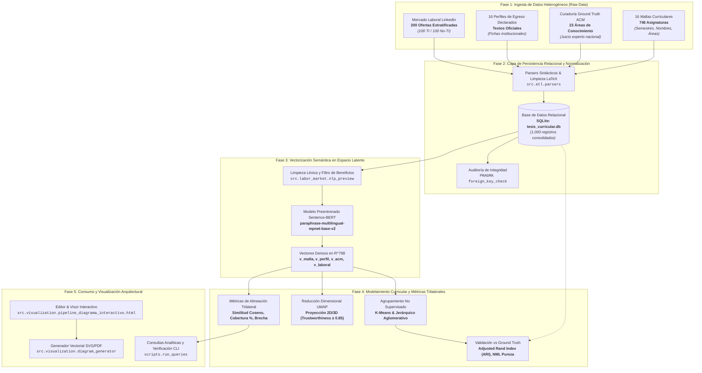

# Arquitectura del Sistema de Análisis Curricular

**Proyecto de Tesis:**  
*"Método computacional basado en procesamiento de lenguaje natural para analizar la alineación curricular de Ingeniería Informática en Chile con estándares ACM/IEEE y necesidades de la industria"*  
**Autor:** Fabián Ibarra Norambuena  
**Institución:** Universidad de Santiago de Chile (USACH)

---

## 1. Visión General y Propósito

El sistema es un **pipeline computacional reproducible** diseñado para resolver el problema de la evaluación y alineación curricular universitaria mediante técnicas avanzadas de Procesamiento de Lenguaje Natural (PLN) y aprendizaje no supervisado.

Tradicionalmente, la evaluación de planes de estudio es un proceso manual, cualitativo y propenso a sesgos subjetivos. Este software implementa una metodología cuantitativa, determinista y auditable que contrasta tres dimensiones curriculares fundamentales:

1. **La Promesa Institucional:** Perfiles de Egreso Declarados normativamente por las 16 carreras analizadas.
2. **La Práctica Curricular:** 746 asignaturas estructuradas en mallas curriculares, contrastadas contra el Ground Truth del estándar internacional ACM/IEEE CS2013 / CC2020.
3. **La Demanda Laboral Real:** Muestra representativa y estratificada de 200 vacantes profesionales de LinkedIn en Chile.

---

## 2. Diagrama de Arquitectura End-to-End

---

## 3. Decisiones Arquitecturales y Justificación Técnica ("Por qué")

### 3.1. Separación Estricta entre Datos Crudos (`data/raw`) y Procesados (`data/processed`)
* **Por qué:** Los archivos LaTeX originales (`Clasificacion_ACM_Mallas_Curriculares.tex` y `Corpus_y_Perfiles_Egreso_16_Universidades.tex`) son fuentes primarias de verdad que no deben ser mutadas en tiempo de ejecución.
* **Beneficio:** Garantiza inmutabilidad y reproducibilidad. El pipeline puede recrear la base de datos completa de forma determinista ante cualquier re-ejecución.

### 3.2. Persistencia en SQLite Relacional con `PRAGMA foreign_keys = ON`
* **Por qué:** Frente a archivos CSV o JSON dispersos propensos a inconsistencias léxicas, SQLite ofrece tipado estructurado, consultas analíticas SQL instantáneas y cumplimiento estricto de integridad referencial.
* **Beneficio:** Imposibilita la existencia de asignaturas huérfanas o programas sin universidad asociada.

### 3.3. Configuración Canónica Centralizada con `Pathlib` (`config/settings.py`)
* **Por qué:** El uso de rutas relativas frágiles (`../../data`) genera fallos cuando un script es invocado desde un subdirectorio o desde terminales remotas.
* **Beneficio:** Portabilidad total. Cualquier script puede ejecutarse desde la raíz o cualquier submódulo sin romper las rutas del sistema de archivos.

### 3.4. Desacoplamiento de Parsers Sintácticos (`src/etl/parsers.py`) y Pipeline (`src/etl/pipeline.py`)
* **Por qué:** El parsing de expresiones regulares complejas en código LaTeX debe ser testeable de manera unitaria e independiente de la base de datos.
* **Beneficio:** Facilita la creación de tests unitarios rápidos (`tests/test_parsers.py`) y aísla posibles cambios en la tipografía de los documentos fuente.

### 3.5. Filtrado de Ruido Corporativo previo a SBERT (`src/labor_market/nlp_preview.py`)
* **Por qué:** Las ofertas laborales de LinkedIn contienen párrafos extensos de beneficios legales o corporativos chilenos (cajas de compensación, convenios, aguinaldos, leyes de inclusión).
* **Beneficio:** Evita que el modelo Sentence-BERT ubique ofertas técnicas en regiones del espacio latente dominadas por términos de Recursos Humanos o Bienestar, preservando la pureza semántica de las competencias tecnológicas.

---

## 4. Estructura de Módulos del Repositorio

| Módulo | Responsabilidad |
| :--- | :--- |
| `config/settings.py` | Definición de rutas canónicas inmutables del proyecto. |
| `src/database/` | Conexión contextual a SQLite y DDL de creación de tablas e índices (`schema.sql`). |
| `src/etl/parsers.py` | Parsers sintácticos para extracción desde LaTeX y JSON. |
| `src/etl/pipeline.py` | Orquestador ETL con validaciones de integridad referencial. |
| `src/labor_market/` | Curaduría, validación estadística, ingesta interactiva y bookmarklet de LinkedIn. |
| `src/visualization/` | Visor interactivo web en Mermaid y renderizador vectorial (SVG/PDF). |
| `scripts/` | Puntos de entrada CLI de ejecución directa (`run_etl.py`, `run_queries.py`, `update_diagram.sh`). |
| `tests/` | Suite automatizada de pruebas de consistencia referencial y pruebas unitarias. |
| `docs/` | Documentación exhaustiva (Arquitectura y Diccionario de Datos). |
