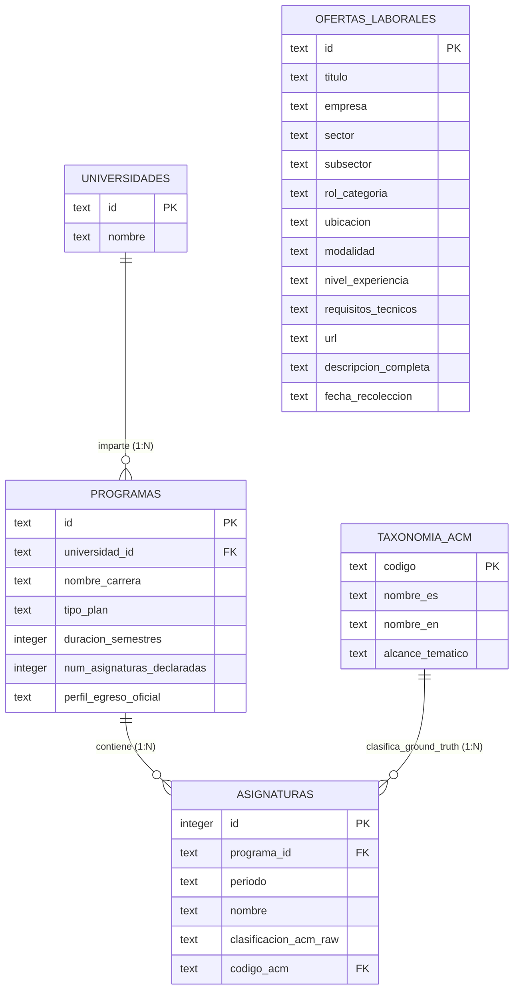

# Diccionario de Datos: Base de Datos Curricular

Este documento detalla formalmente el esquema relacional de la base de datos `tesis_curricular.db` (SQLite), sus restricciones de integridad referencial, tipos de datos y la taxonomía nacional de Áreas de Conocimiento ACM/IEEE CS2013/CC2020.

---

## 1. Diagrama Entidad-Relación

---

## 2. Descripción Detallada de Tablas

### 2.1. Tabla: `taxonomia_acm`
Catálogo unificado de las 23 Áreas de Conocimiento (Knowledge Areas) del estándar ACM/IEEE CS2013 adaptadas al contexto nacional chileno.

| Campo | Tipo | Nulo | Descripción |
| :--- | :--- | :--- | :--- |
| `codigo` | `TEXT` | NO (PK) | Código mnemotécnico canónico (e.g., `AL`, `SE`, `DM`, `IS`). |
| `nombre_es` | `TEXT` | NO | Denominación formal en español utilizada en la clasificación experta. |
| `nombre_en` | `TEXT` | SÍ | Denominación canónica oficial en inglés según ACM/IEEE CS2013. |
| `alcance_tematico` | `TEXT` | SÍ | Descripción sintética del dominio y materias comprendidas. |

### 2.2. Tabla: `universidades`
Catálogo de las 15 instituciones de educación superior analizadas en el corpus de la tesis.

| Campo | Tipo | Nulo | Descripción |
| :--- | :--- | :--- | :--- |
| `id` | `TEXT` | NO (PK) | Sigla institucional normalizada (e.g., `USACH`, `UCHILE`, `PUCV`, `UA`). |
| `nombre` | `TEXT` | NO | Nombre oficial completo de la institución de educación superior. |

### 2.3. Tabla: `programas`
Los 16 planes de estudio evaluados (incluye los dos planes de USACH: Ejecución y Civil).

| Campo | Tipo | Nulo | Descripción |
| :--- | :--- | :--- | :--- |
| `id` | `TEXT` | NO (PK) | Identificador único de programa (formato: `{SIGLA}_{ORDEN}`, ej. `USACH_01`). |
| `universidad_id` | `TEXT` | NO (FK) | Clave foránea que referencia a `universidades.id`. |
| `nombre_carrera` | `TEXT` | NO | Nombre formal de la carrera (e.g., *Ingeniería Civil en Informática*). |
| `tipo_plan` | `TEXT` | SÍ | Tipología del plan: `Civil`, `Ejecución`, o `Profesional`. |
| `duracion_semestres`| `INTEGER`| SÍ | Duración nominal oficial del plan en semestres lectivos (8 a 11). |
| `num_asignaturas_declaradas` | `INTEGER` | SÍ | Conteo de asignaturas reportadas en la ficha del programa. |
| `perfil_egreso_oficial` | `TEXT` | SÍ | Texto normativo e institucional del perfil de egreso declarado. |

### 2.4. Tabla: `asignaturas`
Las 746 asignaturas de las 16 mallas, etiquetadas con su Ground Truth curricular.

| Campo | Tipo | Nulo | Descripción |
| :--- | :--- | :--- | :--- |
| `id` | `INTEGER` | NO (PK) | Identificador correlativo autonumérico de la asignatura. |
| `programa_id` | `TEXT` | NO (FK) | Clave foránea que referencia a `programas.id`. |
| `periodo` | `TEXT` | NO | Nivel o semestre lectivo donde se dicta (e.g., `Semestre 1`, `Nivel 5`). |
| `nombre` | `TEXT` | NO | Nombre de la asignatura tal como figura en el plan de estudios. |
| `clasificacion_acm_raw` | `TEXT` | NO | Nombre textual del área asignada en la curaduría inicial. |
| `codigo_acm` | `TEXT` | SÍ (FK) | Código de referencia hacia `taxonomia_acm.codigo` (Ground Truth validado). |

### 2.5. Tabla: `ofertas_laborales`
Muestra estratificada de 200 vacantes de empleo levantadas desde LinkedIn en Chile.

| Campo | Tipo | Nulo | Descripción |
| :--- | :--- | :--- | :--- |
| `id` | `TEXT` | NO (PK) | Identificador correlativo (`JOB-TI-001` al `100` / `JOB-NOTI-001` al `100`). |
| `titulo` | `TEXT` | NO | Cargo publicado (e.g., *Software Engineer*, *Data Engineer*). |
| `empresa` | `TEXT` | NO | Nombre de la entidad empleadora. |
| `sector` | `TEXT` | NO | Estratificación muestral: `TI` o `No-TI`. |
| `subsector` | `TEXT` | SÍ | Rubro específico (e.g., *Banca*, *Minería*, *SaaS*, *Retail*). |
| `rol_categoria` | `TEXT` | SÍ | Agrupación funcional (Backend, Frontend, Data, DevOps, etc.). |
| `ubicacion` | `TEXT` | SÍ | Ciudad / región geográfica de la vacante. |
| `modalidad` | `TEXT` | SÍ | Régimen laboral (`Remoto`, `Híbrido`, `Presencial`). |
| `nivel_experiencia` | `TEXT` | SÍ | Seniority solicitado (Junior, Semi-Senior, Senior, Lead). |
| `requisitos_tecnicos`| `TEXT` | SÍ | Tecnologías detectadas separadas por comas. |
| `url` | `TEXT` | SÍ | Enlace canónico de la publicación en LinkedIn. |
| `descripcion_completa`| `TEXT` | SÍ | Cuerpo textual íntegro de la oferta para vectorización SBERT. |
| `fecha_recoleccion` | `TEXT` | SÍ | Fecha de captura en formato ISO `YYYY-MM-DD`. |

---

## 3. Catálogo Canónico de las 23 Áreas de Conocimiento ACM/IEEE

| Código | Denominación en Español | Denominación en Inglés |
| :--- | :--- | :--- |
| `AL` | Algoritmos y Complejidad | Algorithms and Complexity |
| `AR` | Arquitectura y Organización | Architecture and Organization |
| `CN` | Ciencias de la Computación | Computational Science |
| `DS` | Estructuras Discretas | Discrete Structures |
| `GV` | Gráficos y Visualización | Graphics and Visual Computing |
| `HCI` | Interacción Humano-Computador | Human-Computer Interaction |
| `IAS` | Aseguramiento de la Información y Seguridad | Information Assurance and Security |
| `IM` | Gestión de la Información | Information Management |
| `IS` | Sistemas Inteligentes | Intelligent Systems |
| `NC` | Redes y Comunicaciones | Networking and Communication |
| `OS` | Sistemas Operativos | Operating Systems |
| `PBD` | Desarrollo Basado en Plataformas | Platform-Based Development |
| `PD` | Computación Paralela y Distribuida | Parallel and Distributed Computing |
| `PL` | Lenguajes de Programación | Programming Languages |
| `SDF` | Fundamentos del Desarrollo de Software | Software Development Fundamentals |
| `SE` | Ingeniería de Software | Software Engineering |
| `SF` | Fundamentos de Sistemas | Systems Fundamentals |
| `SP` | Aspectos Sociales y Práctica Profesional | Social Issues and Professional Practice |
| `SEP` | Sociedad, Ética y Profesionalismo | Society, Ethics and Professionalism |
| `EL` | Electivos / Tópicos de Especialización | Elective / Advanced Topics |
| `CE` | Ciencias Exactas (Física, Química) | Exact Sciences |
| `MS` | Fundamentos Matemáticos y Estadísticos | Mathematical and Statistical Foundations |
| `FL` | Idiomas (Inglés Técnico) | Foreign Languages |
| `CS` | Ciencias Sociales y Formación Integral | Social Sciences |
| `CP` | Trabajo de Titulación / Capstone Project | Capstone Project / Thesis |
